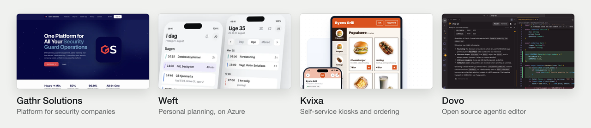

# Jawad Mehmood Khan Qayyum

Software engineer in Copenhagen. Analyst at [Netcompany](https://www.netcompany.com) from 1 December 2026. Founder of [Gathr Solutions](https://gathrsolutions.dk) and [Weft](https://weft.azurewebsites.net). MSc student in Software Engineering at Aalborg University Copenhagen.

[Portfolio](https://jmkq0056.github.io/Portfolio/) · [LinkedIn](https://www.linkedin.com/in/jawad-mehmood-khan-qayyum/) · [Email](mailto:Jawa0056@gmail.com)

<picture>
  <source media="(prefers-color-scheme: dark)" srcset="assets/github-dark.png">
  
</picture>

Most of my code lives in private repositories, because it runs products in production. The graph below counts that work without showing the code. The pinned repositories are what I can show in public.

## What I build

| Project | What it is | Built with |
| --- | --- | --- |
| **[Gathr Solutions](https://gathrsolutions.dk)** | Workforce platform for Danish security companies: shift planning, patrols verified at NFC, QR, BLE and GPS checkpoints, incident alerts, time tracking, a customer portal and end to end encrypted chat on Matrix, with a self-hosted homeserver written in Rust. Live on the [App Store](https://apps.apple.com/dk/app/gathr-solutions/id6743261771) and [Google Play](https://play.google.com/store/apps/details?id=com.secureservicegroup.app). I am the sole engineer, over 300,000 lines written with agentic tooling. | Google Cloud, Matrix (Continuwuity, vodozemac), CI/CD, Playwright, iOS and Android |
| **[Weft](https://weft.azurewebsites.net)** | One plan for work, study and training that rearranges itself when something moves. The platform runs on Azure today, and the product features are being finished before release. | C#/.NET 8, Azure SQL, Entra ID, Bicep, GitHub Actions, React Native |
| **[Kvixa](https://kvixa.vestegnensit.dk)** | Self-service kiosks and online ordering for grill bars and cafés, built as a team of three at Vestegnens IT-løsninger. [Chicken N Chicken Waves](https://chickenwaves.dk) and [Tasty Corner](https://tastycorner.dk) take their orders on it every day. | Node.js, MongoDB, Kotlin and Compose, Flutter, Docker |
| **[Dovo](https://github.com/jmkq0056/dovo)** | Open source editor, a VS Code fork rebuilt around terminal coding agents such as the Claude Code CLI. Released for macOS and Windows. | TypeScript, Electron, GitHub Actions |
| **Educado** | Open source education platform. I built the CI/CD pipelines, Docker delivery and automated deployment. Semester project, graded 10. | Node.js, MongoDB, React, Docker |
| **Privacy preserving ride sharing** | Bachelor project on socially aware bipartite matching with non interference privacy. Graded 12. | Algorithms, privacy |
| **A language for smart lighting** | Grammar and interpreter for a scripting language that controls Philips Hue lights, with a REST API on Azure. | Java, C#/.NET 8, Azure |

## Now

- Starting at Netcompany on 1 December 2026
- MSc in Software Engineering at Aalborg University Copenhagen, BSc weighted GPA 8.8, bachelor project graded 12
- Teaching assistant in Database Systems at AAU, the second course I have taught there
- Running Gathr Solutions and building Weft

## What I work with

Also SQL, Matrix, Entra ID, Bicep, Playwright, Power BI, and agentic development with Claude Code.
